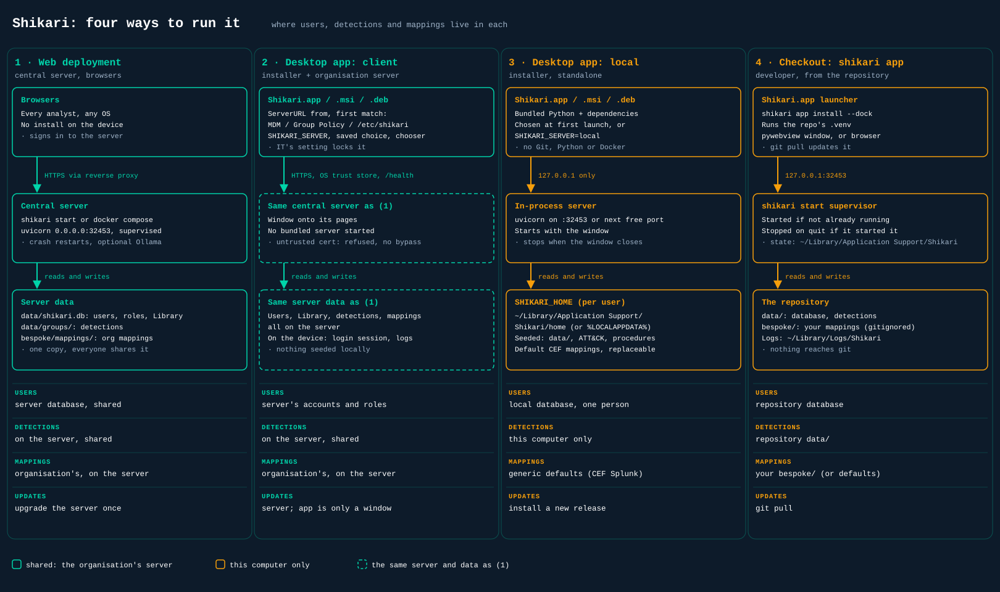

# Desktop App

Archer ships two ways to run as an application with a Dock, Start menu or launcher icon.



| | Installer (this folder) | `archer-cli app` |
|---|---|---|
| For | Anyone: download, install, open | A checkout you develop in |
| Runs | Its own bundled Python and dependencies | The repository's `.venv` |
| Data | A per-user folder (below) | The repository, as `archer-cli start` does |
| Updates | A new installer | `git pull` |

## Installing

Download the file for your machine from the repository's Releases page:

| File | For |
|---|---|
| `Archer-<version>-macos-arm64.dmg` | Apple Silicon Macs |
| `Archer-<version>-macos-x86_64.dmg` | Intel Macs |
| `Archer-<version>-windows-x64.msi` | Windows 10 and 11 |
| `archer_<version>-1~ubuntu-noble_amd64.deb` | Ubuntu 24.04 and Debian-based distributions (x86_64) |

The builds aren't signed with a paid developer certificate yet, so the first launch needs one extra step. On macOS, opening it shows "Apple could not verify Archer"; open System Settings > Privacy & Security and choose Open Anyway. On Windows, SmartScreen shows "Windows protected your PC"; choose More info > Run anyway. On Linux, install the package with `sudo apt install ./archer_<version>-1~ubuntu-noble_amd64.deb`, which pulls in GTK and WebKit, and open Archer from the applications menu.

The first launch asks how to use it:

- **Connect to your organisation's Archer**: the app becomes a window onto the central server, with that server's users, library, detections and mappings. Nothing is stored or run locally apart from the login session, and upgrading the server upgrades everyone.
- **Run Archer on this computer**: the app runs its own server (on 127.0.0.1 only, port 8000 or the next free one) and stops it when the window closes. The first run takes a minute or two while it builds its caches.

Archer > Change Server switches later. Data made in local mode stays on that computer.

## Connecting an Organisation

Deploy Archer centrally as usual (`scripts/deployment/DEPLOY.md`) behind HTTPS, then point the apps at it. Users can type the address into the first-run screen, or IT can set it, which skips that screen and removes Change Server:

| | Setting |
|---|---|
| macOS | A configuration profile from your MDM: preference domain `com.cmdaltr.archer`, key `ServerURL` (string) |
| Windows | Group Policy or Intune: `HKLM\SOFTWARE\Policies\cmdaltr\Archer`, string value `ServerURL` (HKCU works too) |
| Linux | `/etc/archer/client.json`: `{"server_url": "https://archer.example.org"}` |
| Any | The environment variable `ARCHER_SERVER` (a URL, or `local`); not locked |

For macOS, the profile's payload is a Custom Settings (`com.apple.ManagedClient.preferences`) payload for `com.cmdaltr.archer`:

```xml
<key>ServerURL</key>
<string>https://archer.example.org</string>
```

The app checks a server before opening it: it must answer `/health` as Archer, over HTTPS with a certificate the operating system trusts. An internal CA works once IT has deployed it to the machines. There's no way to click through a certificate error. A user can't type a plain `http://` address except for this computer; IT's setting and `ARCHER_SERVER` can, for a server on a trusted network.

## Where Your Data Lives

In local mode (connected to a server, this folder only holds the login session and logs):

| | Folder |
|---|---|
| macOS | `~/Library/Application Support/Archer/home` |
| Windows | `%LOCALAPPDATA%\Archer\home` |
| Linux | `~/.local/share/archer/home` |

The folder holds the database, generated detections, caches, logs (`logs/archer.log`) and `bespoke/`. Uninstalling the app leaves it in place; delete it to start again. Set `ARCHER_HOME` to use another folder.

The first run fills it from the installer: the reference data in the repository's `data/`, the ATT&CK bundle and the procedures CSV built from it at release time, and generic mappings in `bespoke/mappings/` (Splunk set up for CEF; see `archer/mappings/defaults/README.md`). Put your organisation's own mappings in `bespoke/mappings/` to replace them: Archer never overwrites a file that's there.

## What the Installed App Doesn't Do

It can't rebuild the procedures CSV itself: MITRESaw needs its own Python environment. A newer ATT&CK release is downloaded at startup as usual, but threat briefings use the CSV from the installer until the next release. The OSINT detection repositories need git; without it (or on a Mac without the developer tools) they're skipped. Ollama is a separate install, which Archer finds as usual.

## Building

`.github/workflows/desktop.yml` builds all four on a `v*` tag, installs the macOS, Windows and Linux packages on clean runners and checks each one serves Archer, then attaches them to a GitHub Release; run it by hand (Actions > Desktop app > Run workflow) for a test build, left as workflow artifacts. A seed job downloads ATT&CK and runs MITRESaw for the procedures CSV, cached per ATT&CK version, so only a release after an ATT&CK update pays the 90 minutes.

To build on your own machine (macOS here; each platform builds only its own installer):

```bash
.venv/bin/python desktop/stage.py --attack archer/data/cache/enterprise-attack.json \
  --procedures data/mitre_procedures.csv data/mitre_procedures.meta.json
cd ~/.cache/archer/desktop
python3.11 -m venv .briefcase && .briefcase/bin/pip install briefcase
.briefcase/bin/briefcase package macOS --adhoc-sign    # dist/Archer-<version>.dmg
```

`desktop/stage.py` copies only what git would include (tracked files and new ones that aren't ignored), so nothing `.gitignore` keeps out of the repository can reach an installer; it builds outside the repository because a build is several hundred MB. The installed app's entry point is `archer/desktop_app.py`; where it puts things is `archer/paths.py`. Icons come from `archer.png` via `desktop/make_icons.py`.
