# Archer — Architecture & Process Diagrams

> **Audience:** Anyone who needs to understand how Archer works — security engineers, managers, stakeholders.
> **Minimal code.** These diagrams focus on *what happens* and *why*, not implementation details.

---

## Master Diagram — The Complete Picture

The master view is split into three connected sections for readability. Read top-to-bottom: **Part A** (input to processing) flows into **Part B** (correlation and enrichment) flows into **Part C** (storage and output).

### Part A — Input, Intelligence & Build

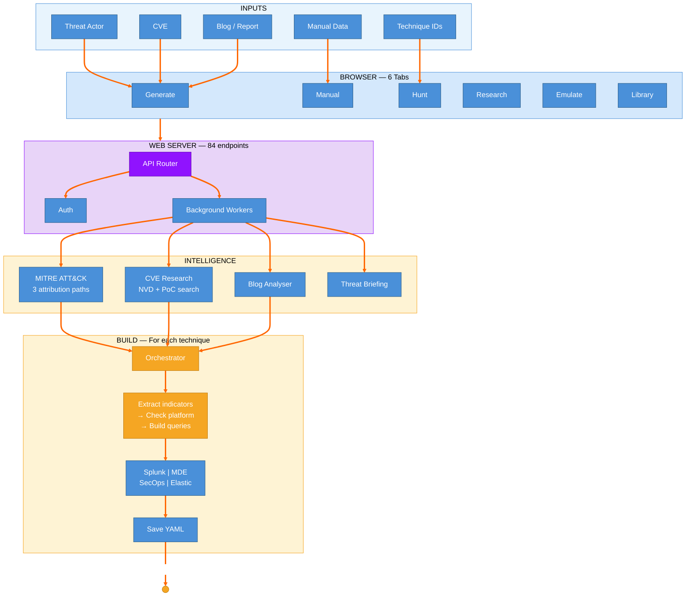

### Part B — Correlation & Enrichment

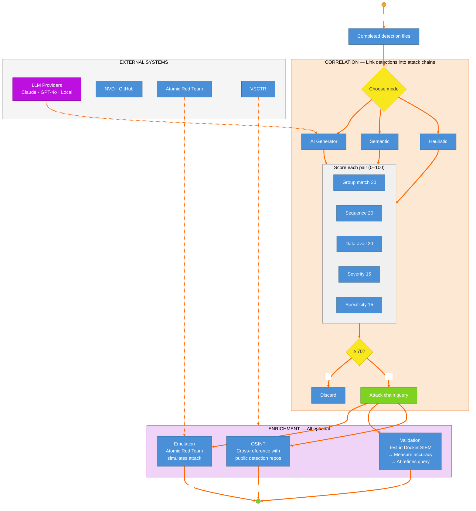

### Part C — Storage & Output

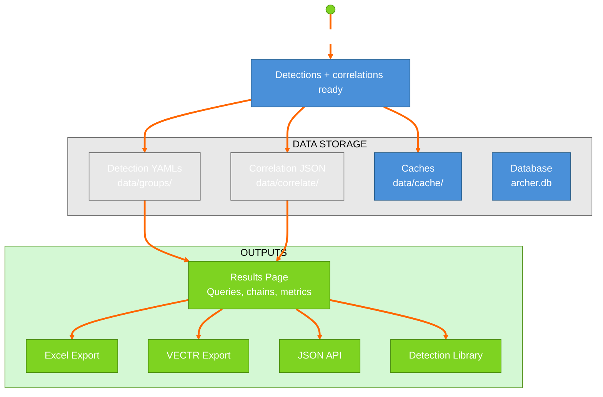

---

## 1. System Overview — What Is Archer?

Archer takes a **threat actor name** (or CVE, or blog post) and automatically produces **detection queries** for your security tools (Splunk, Microsoft Defender, Google SecOps, Elastic). It does this by looking up what that threat actor actually does (via MITRE ATT&CK), then building tailored searches for each technique.

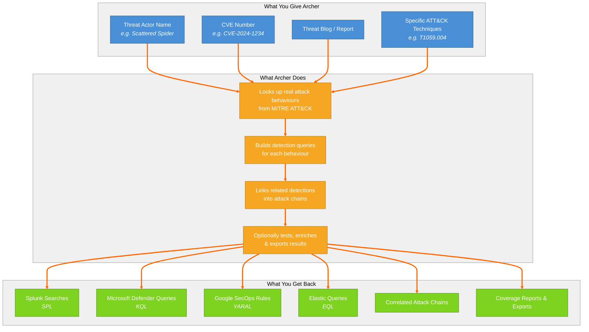

---

## 2. Core Process — End-to-End Flow

This is the full journey from "I want detections for Scattered Spider" to finished queries.

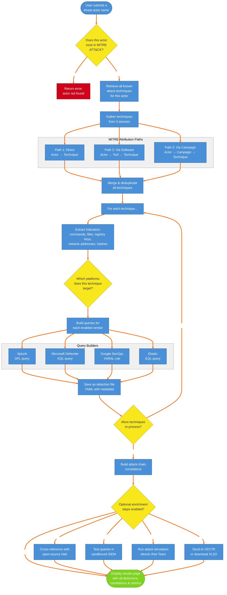

---

## 3. Component Architecture — How the Parts Fit Together

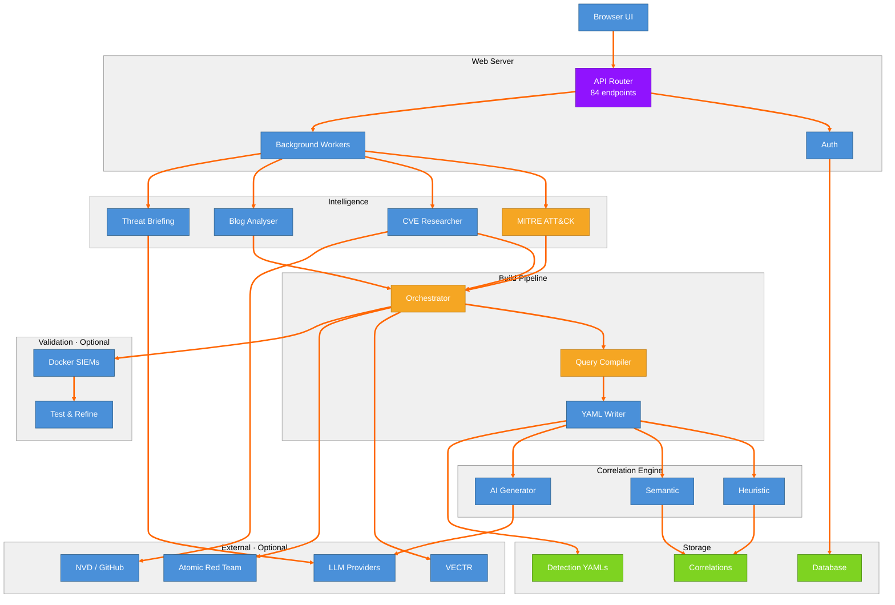

---

## 4. Decision Map — Every Choice Archer Makes

```mermaid
%%{init: {'theme': 'base', 'themeVariables': {'lineColor': '#ff6600', 'edgeLabelBackground': '#ffffff', 'primaryColor': '#4a90d9', 'primaryTextColor': '#ffffff', 'primaryBorderColor': '#2c5f8a', 'secondaryColor': '#e8e8e8', 'tertiaryColor': '#f5f5f5', 'clusterBkg': '#f0f0f0', 'clusterBorder': '#999999', 'titleColor': '#000000', 'nodeTextColor': '#000000', 'background': '#ffffff'}}}%%
flowchart TD
    subgraph "Input Decisions"
        D1{"What type of input?"}
        D1 -- "Threat Actor" --> D1A["Look up in MITRE ATT&CK"]
        D1 -- "CVE Number" --> D1B["Query NVD vulnerability DB<br/>+ search for exploit code"]
        D1 -- "Blog / Report" --> D1C["Parse text for IOCs,<br/>tools, and techniques"]
        D1 -- "Specific Techniques" --> D1D["Resolve technique details<br/>directly from ATT&CK"]
    end

    subgraph "Attribution Decisions"
        D2{"How is this technique<br/>linked to the actor?"}
        D2 -- "Direct use" --> D2A["Highest confidence<br/><i>Actor personally used it</i>"]
        D2 -- "Via a tool they use" --> D2B["Medium confidence<br/><i>Actor uses software X,<br/>which has this capability</i>"]
        D2 -- "Via a campaign" --> D2C["Lower confidence<br/><i>Actor ran campaign Y,<br/>which involved this</i>"]
    end

    subgraph "Query Building Decisions"
        D3{"Which security tools<br/>should we target?"}
        D3 -- "Not excluded" --> D3A["Build query for<br/>this vendor"]
        D3 -- "Excluded by user" --> D3B["Skip this vendor"]

        D4{"Does this technique<br/>apply to this<br/>vendor's platform?"}
        D4 -- "Yes" --> D4A["Generate the query"]
        D4 -- "No" --> D4B["Skip — technique doesn't<br/>produce relevant telemetry<br/>on this platform"]
    end

    subgraph "Correlation Decisions"
        D5{"Which correlation<br/>mode to use?"}
        D5 -- "Default" --> D5A["Heuristic<br/><i>Rule-based matching:<br/>same tactic, platform,<br/>data source overlap</i>"]
        D5 -- "Advanced" --> D5B["Semantic<br/><i>Parse query structure,<br/>find logical relationships</i>"]
        D5 -- "AI-Assisted" --> D5C["AI Generator<br/><i>Ask LLM to suggest<br/>related technique chains</i>"]
        D5 -- "On-Premise" --> D5D["Local LLM<br/><i>Same as AI but runs<br/>on your own hardware</i>"]
    end

    subgraph "Relevance Scoring<br/><i>Each correlation gets a 0–100 score</i>"
        D6["Group/platform match → 30 points"]
        D7["Position in attack chain → 20 points"]
        D8["Data availability → 20 points"]
        D9["Severity level → 15 points"]
        D10["Tactic specificity → 15 points"]
        D11{"Score ≥ 70?"}
        D11 -- "Yes" --> D11A["Include in results"]
        D11 -- "No" --> D11B["Discard — not relevant enough"]
    end

    subgraph "Enrichment Decisions<br/><i>All optional, user-selected</i>"
        D12{"OSINT enabled?"}
        D12 -- "Yes" --> D12A["Cross-check queries against<br/>public detection repos<br/><i>MITRE CAR, Elastic rules</i>"]
        D12 -- "No" --> D12B["Skip"]

        D13{"Validation enabled?"}
        D13 -- "Yes" --> D13A["Spin up test SIEM in Docker<br/>→ Generate fake events<br/>→ Run query<br/>→ Measure accuracy<br/>→ Suggest improvements"]
        D13 -- "No" --> D13B["Skip"]

        D14{"Emulation enabled?"}
        D14 -- "Yes" --> D14A["Run Atomic Red Team tests<br/>to simulate the attack<br/>and verify detection fires"]
        D14 -- "No" --> D14B["Skip"]
    end

    D1A --> D2
    D1B --> D3
    D1C --> D3
    D1D --> D3
    D2A --> D3
    D2B --> D3
    D2C --> D3
    D3A --> D4
    D4A --> D5
    D5A --> D6
    D5B --> D6
    D5C --> D6
    D5D --> D6
    D6 --> D7 --> D8 --> D9 --> D10 --> D11
    D11A --> D12
    D12A --> D13
    D12B --> D13
    D13A --> D14
    D13B --> D14

    style D1 fill:#f8e71c,stroke:#b8a700,color:#333
    style D2 fill:#f8e71c,stroke:#b8a700,color:#333
    style D3 fill:#f8e71c,stroke:#b8a700,color:#333
    style D4 fill:#f8e71c,stroke:#b8a700,color:#333
    style D5 fill:#f8e71c,stroke:#b8a700,color:#333
    style D11 fill:#f8e71c,stroke:#b8a700,color:#333
    style D12 fill:#f8e71c,stroke:#b8a700,color:#333
    style D13 fill:#f8e71c,stroke:#b8a700,color:#333
    style D14 fill:#f8e71c,stroke:#b8a700,color:#333
    linkStyle default stroke:#ff6600,stroke-width:3px
```

---

## 5. Data Flow — What Goes Where

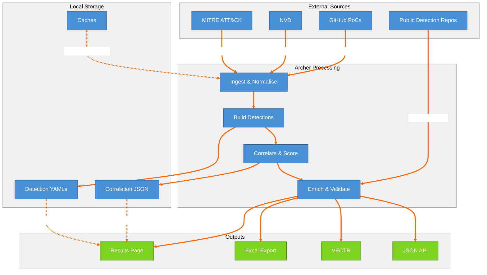

---

## 6. Integration Map — External Systems

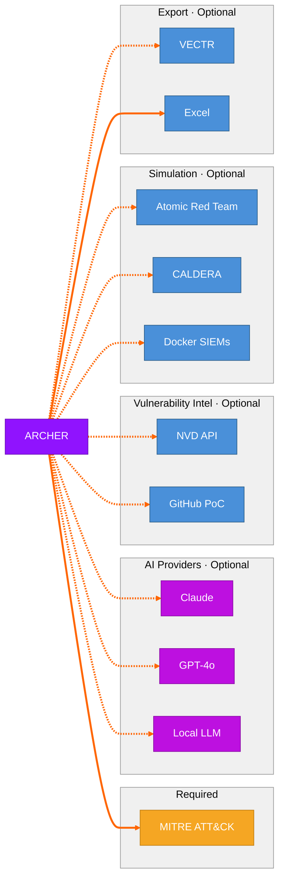

---

## 7. User Interface — The Six Tabs

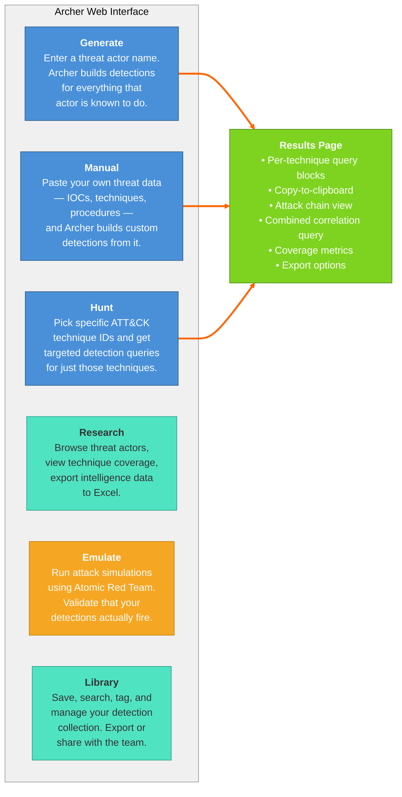

---

## 8. Validation Workflow — Testing Detections

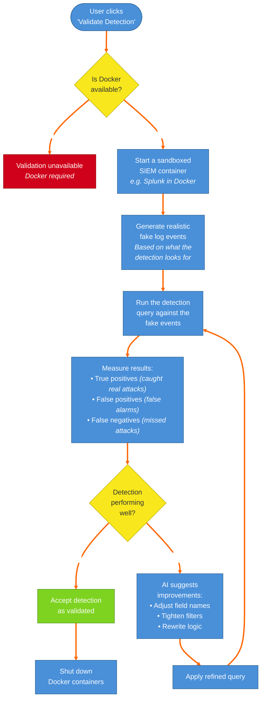

---

## 9. CVE Workflow — Vulnerability-Based Detection

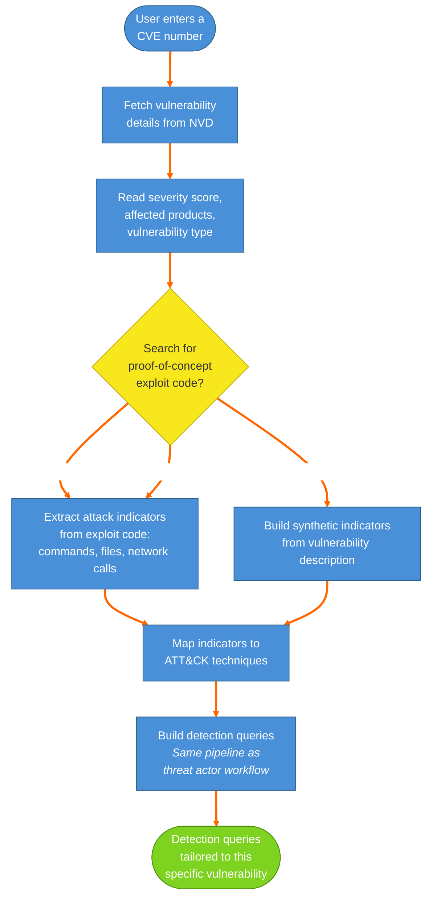

---

## 10. Correlation Engine — How Attack Chains Are Built

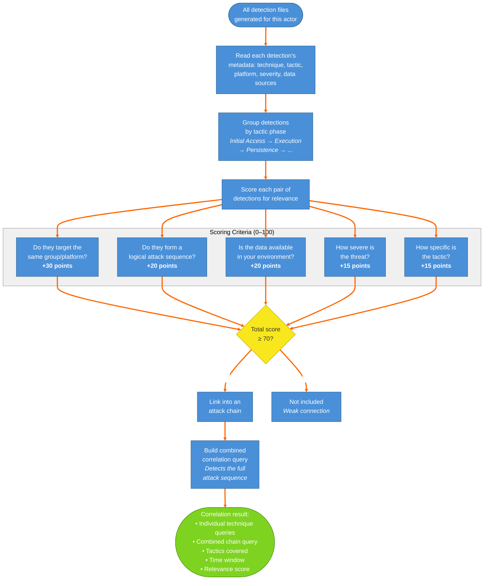

---

## Quick Reference — Explaining Archer in One Paragraph

> **Archer** is a tool that turns threat intelligence into working detection queries. You give it the name of a threat actor (like "Scattered Spider"), and it looks up every attack technique that actor is known to use — drawing from the industry-standard MITRE ATT&CK database. For each technique, it extracts the specific indicators (commands, files, network addresses) and builds tailored search queries for your security tools (Splunk, Microsoft Defender, Google SecOps, or Elastic). It then links related detections into attack chains so you can spot multi-step intrusions, not just individual events. Optionally, it can test those detections in a sandboxed environment, cross-reference them against public intelligence, simulate the actual attacks, and export everything to your purple team platform or a spreadsheet.
