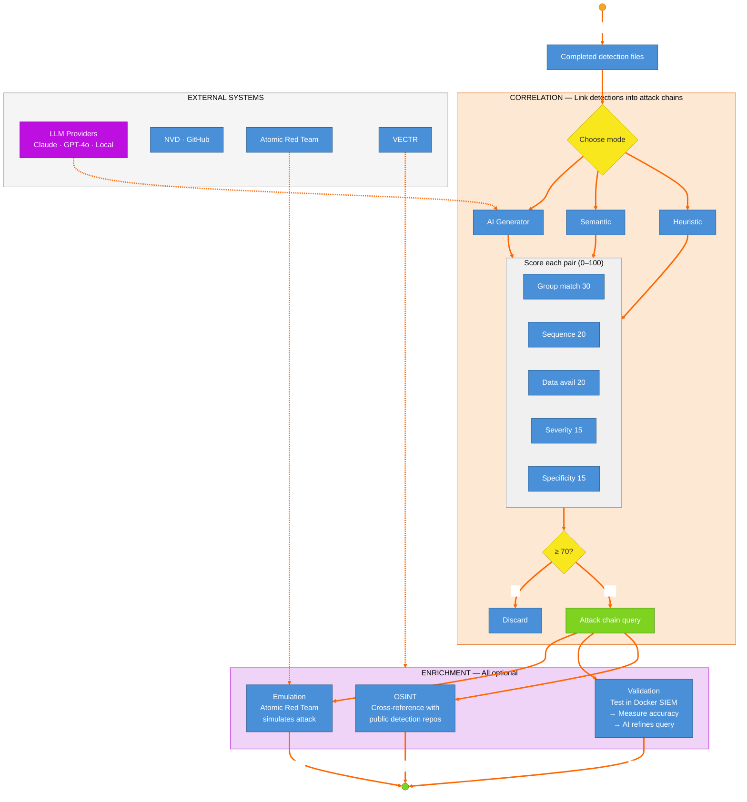

# Part B — Correlation & Enrichment

Part B of the master diagram. Shows how completed detection files are correlated into attack chains (via heuristic, semantic, or AI modes), scored for relevance (0-100), and optionally enriched through OSINT cross-referencing, Docker-based validation, and Atomic Red Team emulation.

