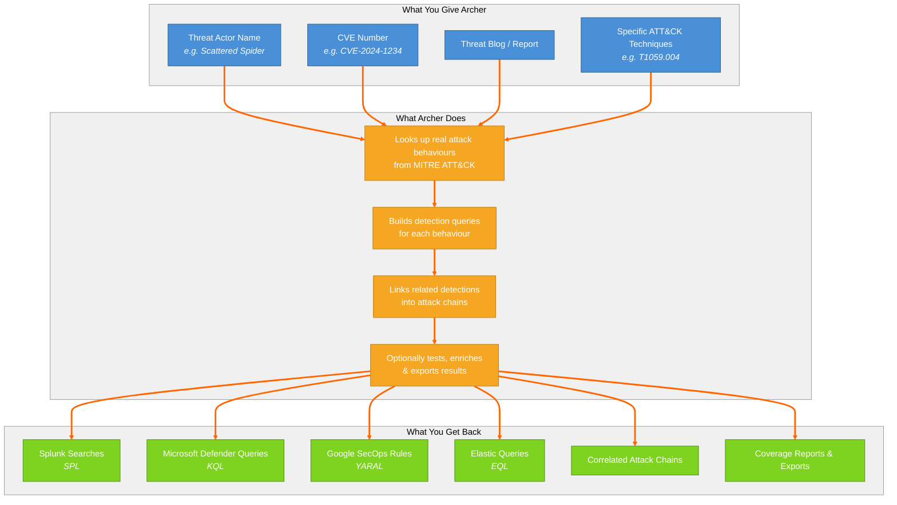

# 1. System Overview — What Is Archer?

High-level overview of Archer. Shows the three columns: what you give Archer (threat actor, CVE, blog, techniques), what Archer does (looks up behaviours, builds queries, links into chains, enriches), and what you get back (Splunk/MDE/SecOps/Elastic queries, attack chains, coverage reports).

