# 4. Decision Map — Every Choice Archer Makes

Maps every decision point in Archer's processing: input type routing, attribution confidence levels, vendor targeting, platform applicability, correlation mode selection, relevance scoring (0-100 with 5 criteria), and optional enrichment toggles (OSINT, validation, emulation).

```mermaid
%%{init: {'theme': 'base', 'themeVariables': {'lineColor': '#ff6600', 'edgeLabelBackground': '#ffffff', 'primaryColor': '#4a90d9', 'primaryTextColor': '#ffffff', 'primaryBorderColor': '#2c5f8a', 'secondaryColor': '#e8e8e8', 'tertiaryColor': '#f5f5f5', 'clusterBkg': '#f0f0f0', 'clusterBorder': '#999999', 'titleColor': '#000000', 'nodeTextColor': '#000000', 'background': '#ffffff'}}}%%
flowchart TD
    subgraph "Input Decisions"
        D1{"What type of input?"}
        D1 -- "Threat Actor" --> D1A["Look up in MITRE ATT&CK"]
        D1 -- "CVE Number" --> D1B["Query NVD vulnerability DB<br/>+ search for exploit code"]
        D1 -- "Blog / Report" --> D1C["Parse text for IOCs,<br/>tools, and techniques"]
        D1 -- "Specific Techniques" --> D1D["Resolve technique details<br/>directly from ATT&CK"]
    end

    subgraph "Attribution Decisions"
        D2{"How is this technique<br/>linked to the actor?"}
        D2 -- "Direct use" --> D2A["Highest confidence<br/><i>Actor personally used it</i>"]
        D2 -- "Via a tool they use" --> D2B["Medium confidence<br/><i>Actor uses software X,<br/>which has this capability</i>"]
        D2 -- "Via a campaign" --> D2C["Lower confidence<br/><i>Actor ran campaign Y,<br/>which involved this</i>"]
    end

    subgraph "Query Building Decisions"
        D3{"Which security tools<br/>should we target?"}
        D3 -- "Not excluded" --> D3A["Build query for<br/>this vendor"]
        D3 -- "Excluded by user" --> D3B["Skip this vendor"]

        D4{"Does this technique<br/>apply to this<br/>vendor's platform?"}
        D4 -- "Yes" --> D4A["Generate the query"]
        D4 -- "No" --> D4B["Skip — technique doesn't<br/>produce relevant telemetry<br/>on this platform"]
    end

    subgraph "Correlation Decisions"
        D5{"Which correlation<br/>mode to use?"}
        D5 -- "Default" --> D5A["Heuristic<br/><i>Rule-based matching:<br/>same tactic, platform,<br/>data source overlap</i>"]
        D5 -- "Advanced" --> D5B["Semantic<br/><i>Parse query structure,<br/>find logical relationships</i>"]
        D5 -- "AI-Assisted" --> D5C["AI Generator<br/><i>Ask LLM to suggest<br/>related technique chains</i>"]
        D5 -- "On-Premise" --> D5D["Local LLM<br/><i>Same as AI but runs<br/>on your own hardware</i>"]
    end

    subgraph "Relevance Scoring<br/><i>Each correlation gets a 0–100 score</i>"
        D6["Group/platform match → 30 points"]
        D7["Position in attack chain → 20 points"]
        D8["Data availability → 20 points"]
        D9["Severity level → 15 points"]
        D10["Tactic specificity → 15 points"]
        D11{"Score ≥ 70?"}
        D11 -- "Yes" --> D11A["Include in results"]
        D11 -- "No" --> D11B["Discard — not relevant enough"]
    end

    subgraph "Enrichment Decisions<br/><i>All optional, user-selected</i>"
        D12{"OSINT enabled?"}
        D12 -- "Yes" --> D12A["Cross-check queries against<br/>public detection repos<br/><i>Elastic, Splunk, Sentinel rules</i>"]
        D12 -- "No" --> D12B["Skip"]

        D13{"Validation enabled?"}
        D13 -- "Yes" --> D13A["Spin up test SIEM in Docker<br/>→ Generate fake events<br/>→ Run query<br/>→ Measure accuracy<br/>→ Suggest improvements"]
        D13 -- "No" --> D13B["Skip"]

        D14{"Check against recordings?"}
        D14 -- "Yes" --> D14A["Emulate: which logs record<br/>the technique, and do the<br/>indicators appear in them?"]
        D14 -- "No" --> D14B["Skip"]
    end

    D1A --> D2
    D1B --> D3
    D1C --> D3
    D1D --> D3
    D2A --> D3
    D2B --> D3
    D2C --> D3
    D3A --> D4
    D4A --> D5
    D5A --> D6
    D5B --> D6
    D5C --> D6
    D5D --> D6
    D6 --> D7 --> D8 --> D9 --> D10 --> D11
    D11A --> D12
    D12A --> D13
    D12B --> D13
    D13A --> D14
    D13B --> D14

    style D1 fill:#f8e71c,stroke:#b8a700,color:#333
    style D2 fill:#f8e71c,stroke:#b8a700,color:#333
    style D3 fill:#f8e71c,stroke:#b8a700,color:#333
    style D4 fill:#f8e71c,stroke:#b8a700,color:#333
    style D5 fill:#f8e71c,stroke:#b8a700,color:#333
    style D11 fill:#f8e71c,stroke:#b8a700,color:#333
    style D12 fill:#f8e71c,stroke:#b8a700,color:#333
    style D13 fill:#f8e71c,stroke:#b8a700,color:#333
    style D14 fill:#f8e71c,stroke:#b8a700,color:#333
    linkStyle default stroke:#ff6600,stroke-width:3px
```

