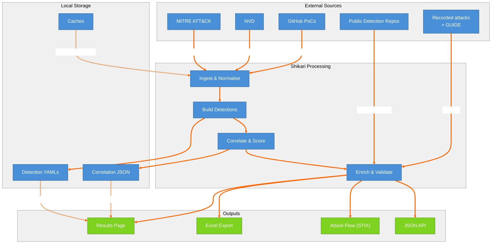

# 5. Data Flow — What Goes Where

Traces data movement through the system: external sources (MITRE, NVD, GitHub, public repos, recorded attacks) → Shikari processing (ingest, build, correlate, enrich) → local storage (YAMLs, JSON, caches) → outputs (results page, Excel, attack flow, JSON API).

