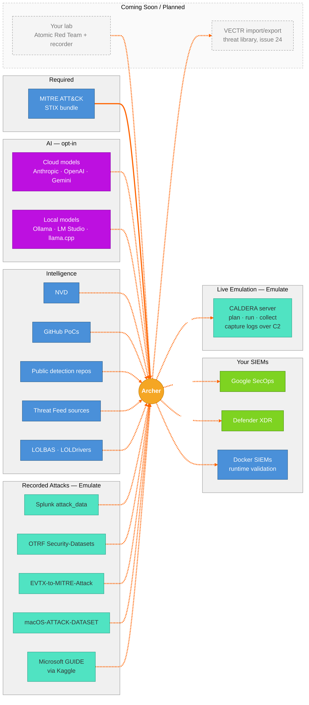

# 6. Integration Map — External Systems

Shows the external systems Archer uses: MITRE ATT&CK (required), AI providers (opt-in: cloud or local), intelligence sources (NVD, GitHub PoCs, public detection repos, Threat Feed sources, LOLBAS and LOLDrivers), recorded attack telemetry and GUIDE, CALDERA for live chained emulation, and your SIEMs. Solid lines = required, dashed = optional, grey = coming soon or planned.

