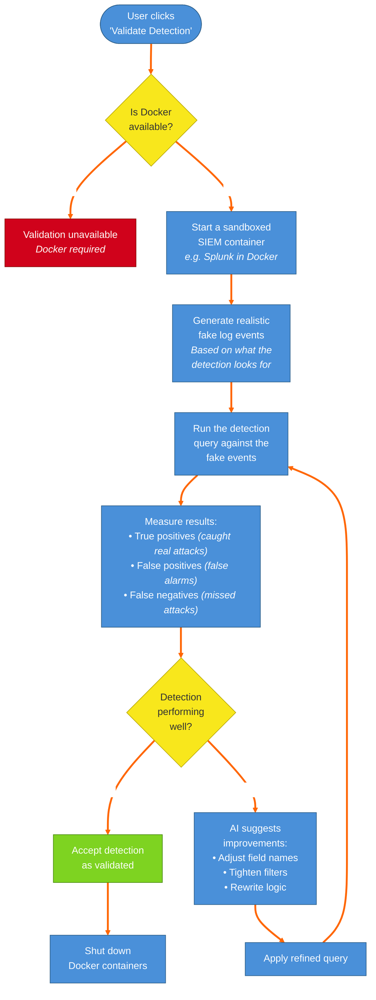

# 8. Validation Workflow — Testing Detections

The detection validation loop: check Docker availability → start sandboxed SIEM → generate realistic test events → run detection query → measure true/false positives and misses → if needs work, AI suggests improvements and re-tests → accept validated detection → clean up containers.

