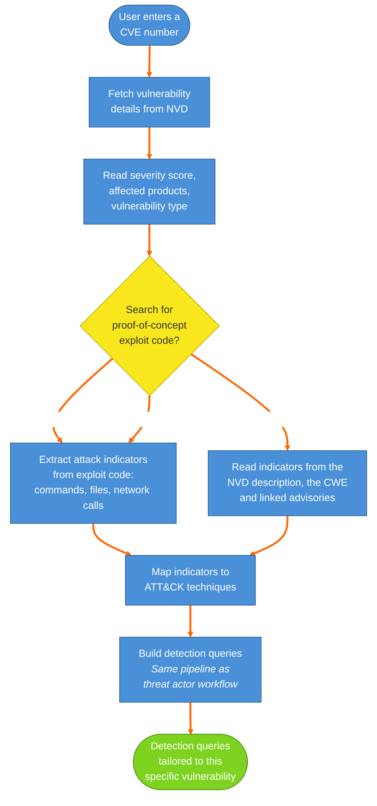

# 9. CVE Workflow — Vulnerability-Based Detection

How Shikari generates detections from a CVE number: fetch vulnerability details from NVD → read severity and affected products → search for proof-of-concept exploit code → extract attack indicators (or fall back to the NVD description, CWE and advisories) → map to ATT&CK techniques → build detection queries using the standard pipeline.

