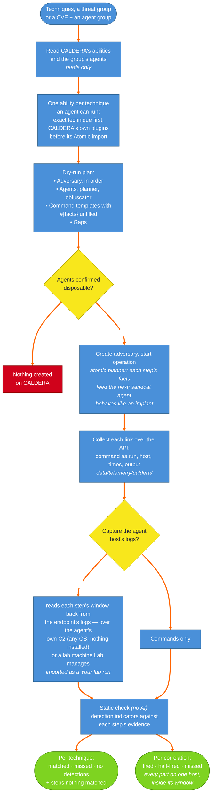

# 11. CALDERA Workflow — Chained Emulation and Static Checks

How a CALDERA operation validates detections and correlations. CALDERA is used for what Atomic Red Team runs can't give: fact chaining between steps and a real implant (sandcat) on the agents. Archer plans the operation first and changes nothing on CALDERA until it's confirmed, then runs it, collects each step's command, host, times and output, optionally captures the agent host's logs over each step's window — over the agent's own C2 (any OS, nothing installed on the host) or a lab machine Lab manages — and checks saved detections and correlations against that evidence statically, with no AI.

