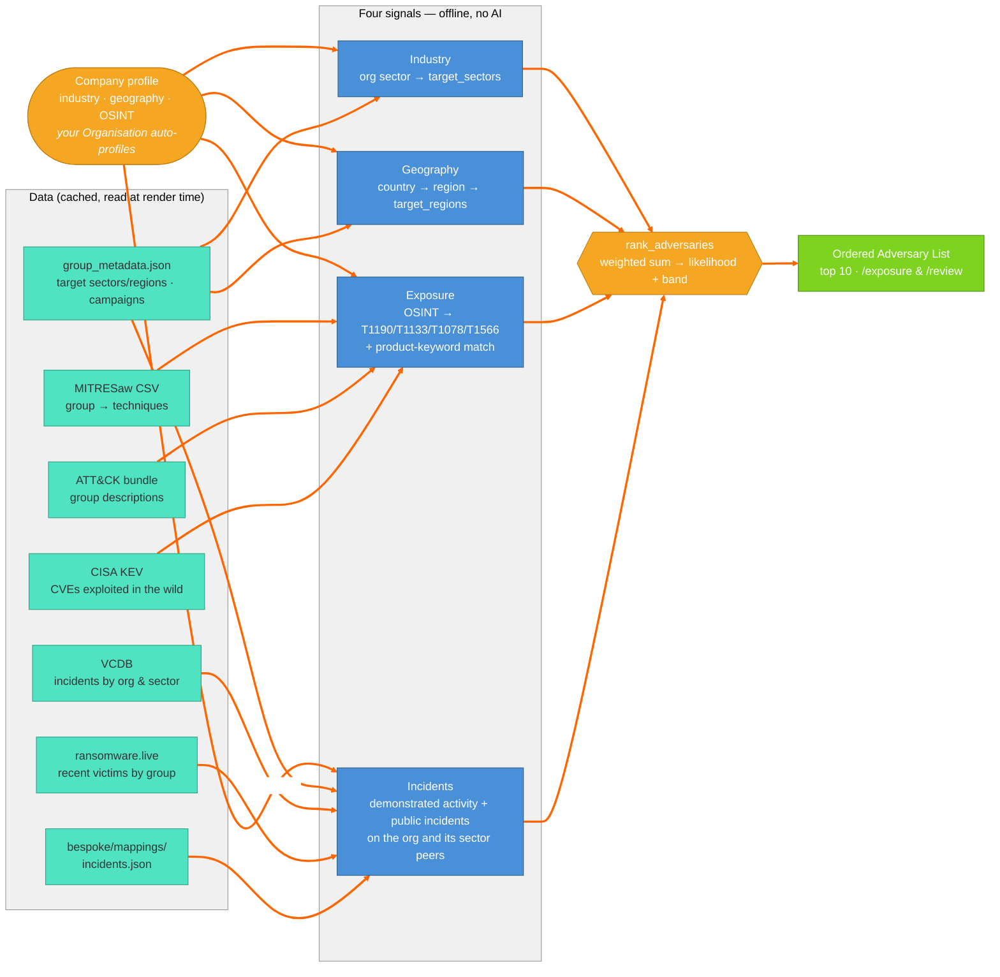

# 12. Adversary Ranking — Who Is Most Likely To Target You

The Ordered Adversary List (`archer.intelligence.adversary_ranking`): the top-10 ATT&CK groups most likely to target a profiled organisation, from four offline, no-AI signals — industry, geography, exposed OSINT and public incidents. Each signal reads data Archer already holds or caches; the ranking combines them into a likelihood and band, shown on /exposure and /review. Setting an **Organisation** on your profile auto-profiles that company and stars it in the catalogue.

