# Shikari — Architecture & Process Diagrams

> **Audience:** Anyone who needs to understand how Shikari works — security engineers, managers, stakeholders.
> **Minimal code.** These diagrams focus on *what happens* and *why*, not implementation details.

---

## Master Diagram — The Complete Picture

The master view is split into three connected sections for readability. Read top-to-bottom: **Part A** (input to processing) flows into **Part B** (correlation and enrichment) flows into **Part C** (storage and output).

### Part A — Input, Intelligence & Build

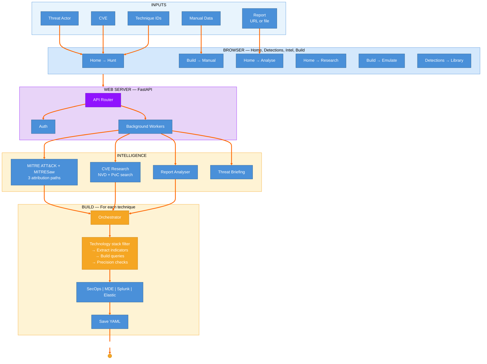

### Part B — Correlation & Enrichment

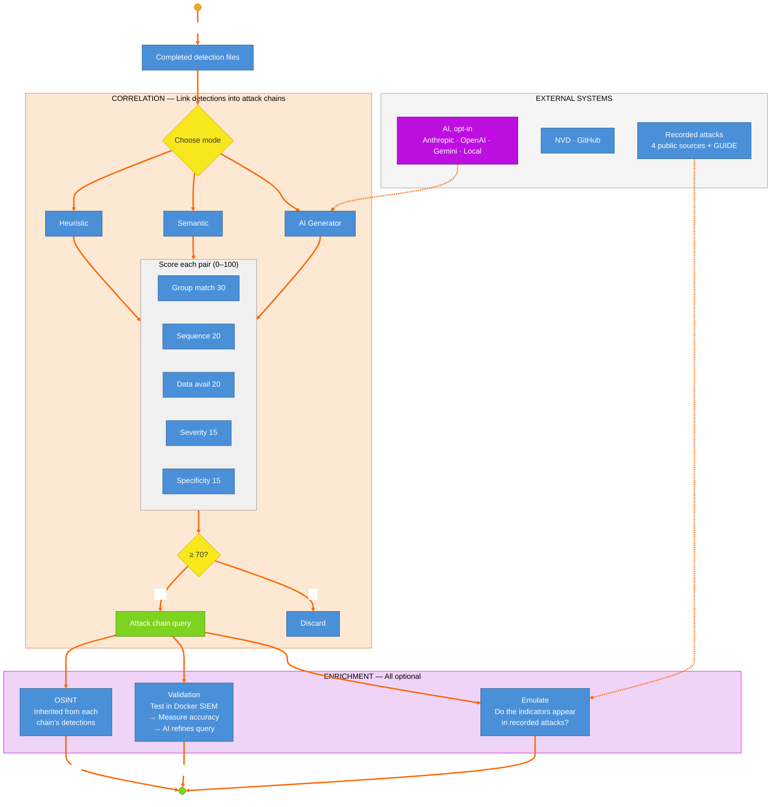

### Part C — Storage & Output

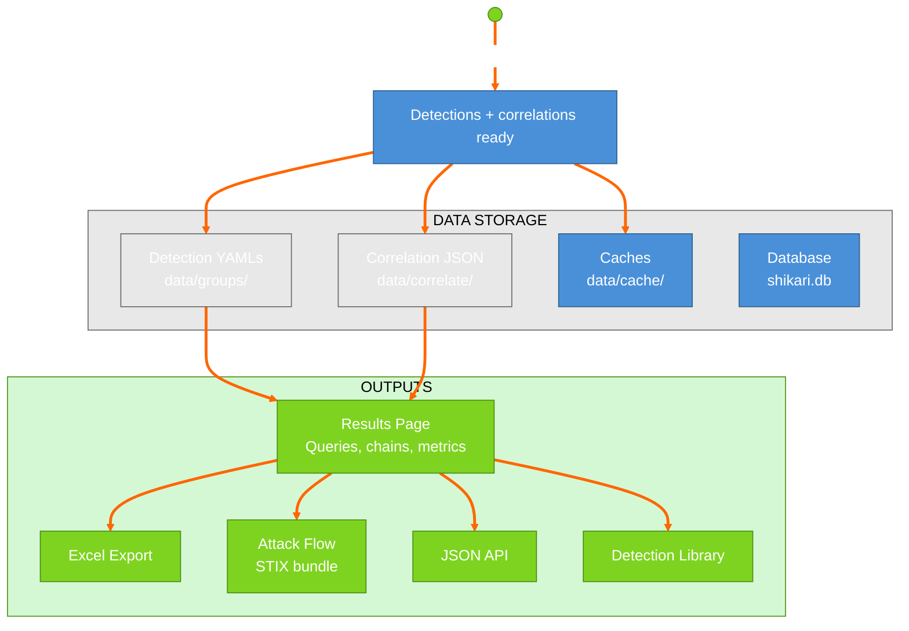

---

## 1. System Overview — What Is Shikari?

Shikari takes a **threat actor name** (or CVE, report, ATT&CK techniques or company) and automatically produces **detection queries** for your SIEMs (Google SecOps, Microsoft Defender XDR, Splunk and Elastic). It does this by looking up what that threat actor actually does (via MITRE ATT&CK), then building tailored searches for each technique.

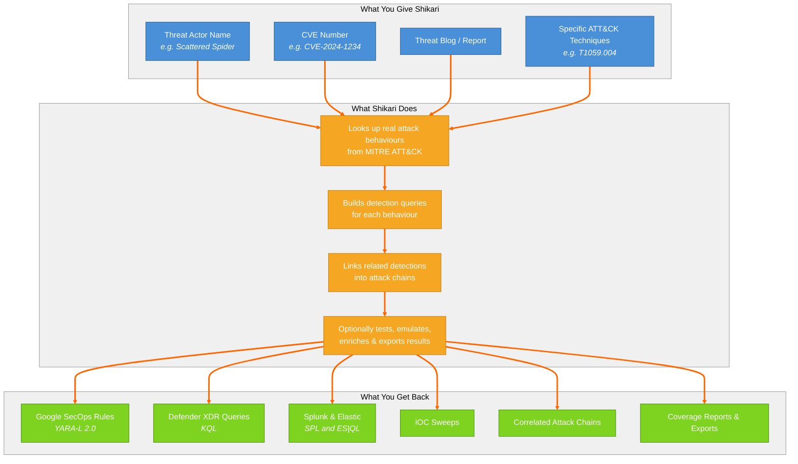

---

## 2. Core Process — End-to-End Flow

This is the full journey from "I want detections for Scattered Spider" to finished queries.

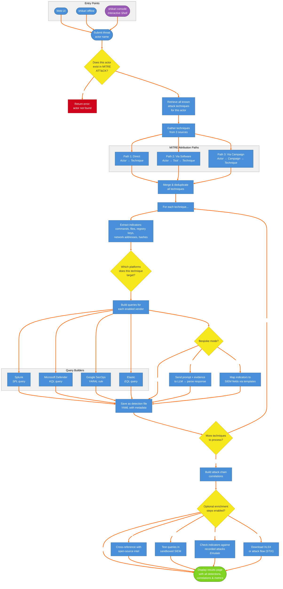

---

## 3. Component Architecture — How the Parts Fit Together

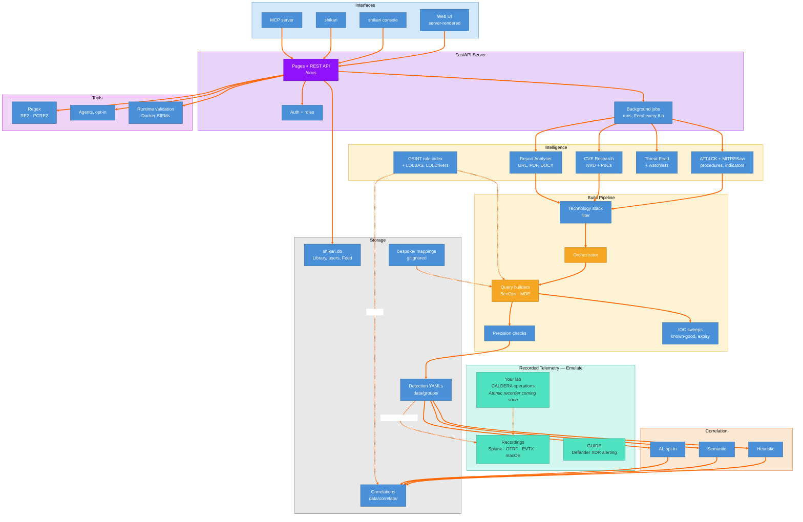

---

## 4. Decision Map — Every Choice Shikari Makes

```mermaid
%%{init: {'theme': 'base', 'themeVariables': {'lineColor': '#ff6600', 'edgeLabelBackground': '#ffffff', 'primaryColor': '#4a90d9', 'primaryTextColor': '#ffffff', 'primaryBorderColor': '#2c5f8a', 'secondaryColor': '#e8e8e8', 'tertiaryColor': '#f5f5f5', 'clusterBkg': '#f0f0f0', 'clusterBorder': '#999999', 'titleColor': '#000000', 'nodeTextColor': '#000000', 'background': '#ffffff'}}}%%
flowchart TD
    subgraph "Input Decisions"
        D1{"What type of input?"}
        D1 -- "Threat Actor" --> D1A["Look up in MITRE ATT&CK"]
        D1 -- "CVE Number" --> D1B["Query NVD vulnerability DB<br/>+ search for exploit code"]
        D1 -- "Blog / Report" --> D1C["Parse text for IOCs,<br/>tools, and techniques"]
        D1 -- "Specific Techniques" --> D1D["Resolve technique details<br/>directly from ATT&CK"]
    end

    subgraph "Attribution Decisions"
        D2{"How is this technique<br/>linked to the actor?"}
        D2 -- "Direct use" --> D2A["Highest confidence<br/><i>Actor personally used it</i>"]
        D2 -- "Via a tool they use" --> D2B["Medium confidence<br/><i>Actor uses software X,<br/>which has this capability</i>"]
        D2 -- "Via a campaign" --> D2C["Lower confidence<br/><i>Actor ran campaign Y,<br/>which involved this</i>"]
    end

    subgraph "Query Building Decisions"
        D3{"Which security tools<br/>should we target?"}
        D3 -- "Not excluded" --> D3A["Build query for<br/>this vendor"]
        D3 -- "Excluded by user" --> D3B["Skip this vendor"]

        D4{"Does this technique<br/>apply to this<br/>vendor's platform?"}
        D4 -- "Yes" --> D4A["Generate the query"]
        D4 -- "No" --> D4B["Skip — technique doesn't<br/>produce relevant telemetry<br/>on this platform"]
    end

    subgraph "Correlation Decisions"
        D5{"Which correlation<br/>mode to use?"}
        D5 -- "Default" --> D5A["Heuristic<br/><i>Rule-based matching:<br/>same tactic, platform,<br/>data source overlap</i>"]
        D5 -- "Advanced" --> D5B["Semantic<br/><i>Parse query structure,<br/>find logical relationships</i>"]
        D5 -- "AI-Assisted" --> D5C["AI Generator<br/><i>Ask LLM to suggest<br/>related technique chains</i>"]
        D5 -- "On-Premise" --> D5D["Local LLM<br/><i>Same as AI but runs<br/>on your own hardware</i>"]
    end

    subgraph "Relevance Scoring<br/><i>Each correlation gets a 0–100 score</i>"
        D6["Group/platform match → 30 points"]
        D7["Position in attack chain → 20 points"]
        D8["Data availability → 20 points"]
        D9["Severity level → 15 points"]
        D10["Tactic specificity → 15 points"]
        D11{"Score ≥ 70?"}
        D11 -- "Yes" --> D11A["Include in results"]
        D11 -- "No" --> D11B["Discard — not relevant enough"]
    end

    subgraph "Enrichment Decisions<br/><i>All optional, user-selected</i>"
        D12{"OSINT enabled?"}
        D12 -- "Yes" --> D12A["Cross-check queries against<br/>public detection repos<br/><i>Elastic, Splunk, Sentinel rules</i>"]
        D12 -- "No" --> D12B["Skip"]

        D13{"Validation enabled?"}
        D13 -- "Yes" --> D13A["Spin up test SIEM in Docker<br/>→ Generate fake events<br/>→ Run query<br/>→ Measure accuracy<br/>→ Suggest improvements"]
        D13 -- "No" --> D13B["Skip"]

        D14{"Check against recordings?"}
        D14 -- "Yes" --> D14A["Emulate: which logs record<br/>the technique, and do the<br/>indicators appear in them?"]
        D14 -- "No" --> D14B["Skip"]
    end

    D1A --> D2
    D1B --> D3
    D1C --> D3
    D1D --> D3
    D2A --> D3
    D2B --> D3
    D2C --> D3
    D3A --> D4
    D4A --> D5
    D5A --> D6
    D5B --> D6
    D5C --> D6
    D5D --> D6
    D6 --> D7 --> D8 --> D9 --> D10 --> D11
    D11A --> D12
    D12A --> D13
    D12B --> D13
    D13A --> D14
    D13B --> D14

    style D1 fill:#f8e71c,stroke:#b8a700,color:#333
    style D2 fill:#f8e71c,stroke:#b8a700,color:#333
    style D3 fill:#f8e71c,stroke:#b8a700,color:#333
    style D4 fill:#f8e71c,stroke:#b8a700,color:#333
    style D5 fill:#f8e71c,stroke:#b8a700,color:#333
    style D11 fill:#f8e71c,stroke:#b8a700,color:#333
    style D12 fill:#f8e71c,stroke:#b8a700,color:#333
    style D13 fill:#f8e71c,stroke:#b8a700,color:#333
    style D14 fill:#f8e71c,stroke:#b8a700,color:#333
    linkStyle default stroke:#ff6600,stroke-width:3px
```

---

## 5. Data Flow — What Goes Where

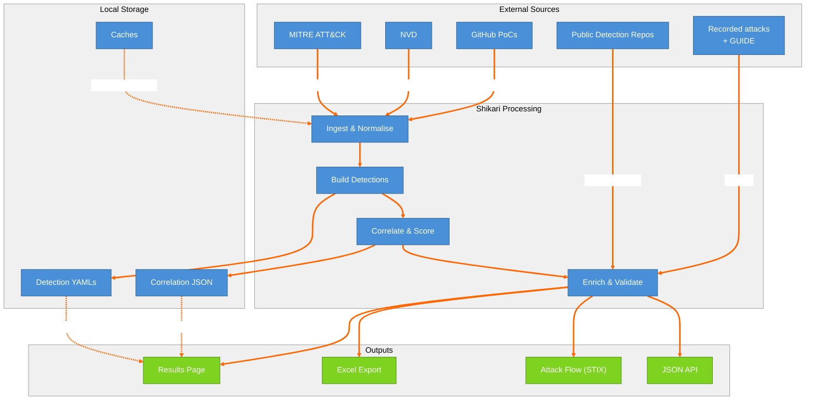

---

## 6. Integration Map — External Systems

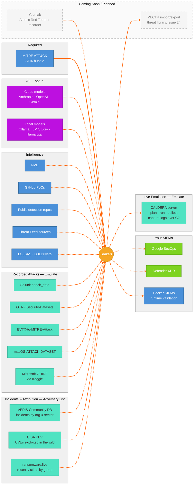

---

## 7. User Interface — Menus and Pages

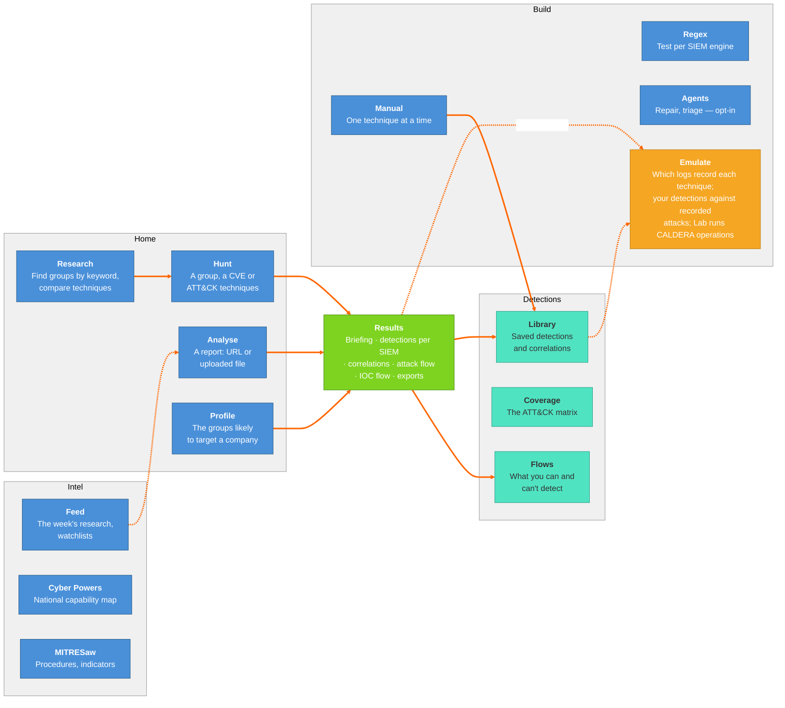

---

## 8. Validation Workflow — Testing Detections

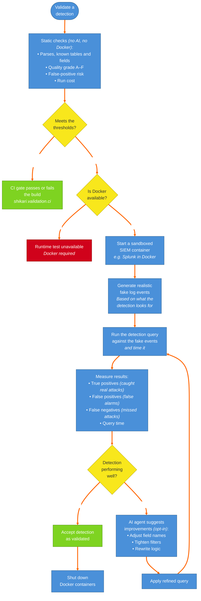

---

## 9. CVE Workflow — Vulnerability-Based Detection

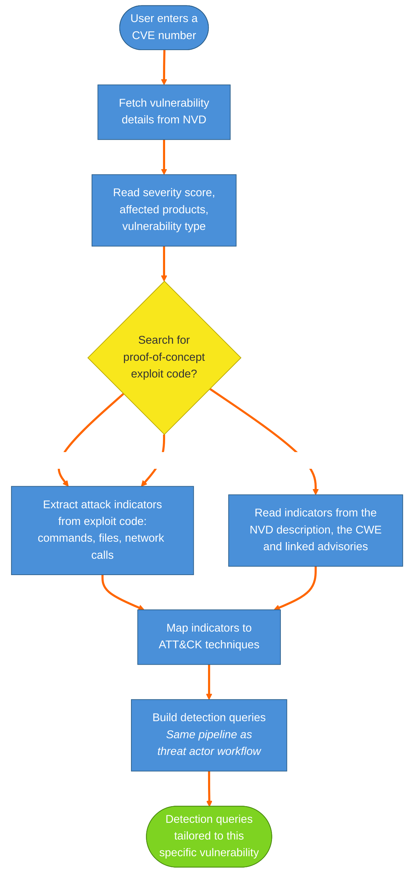

---

## 10. Correlation Engine — How Attack Chains Are Built

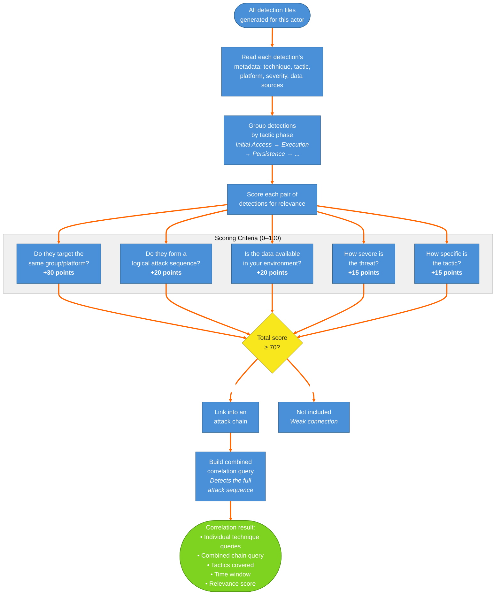

---

## 11. CALDERA Workflow — Chained Emulation and Static Checks

How a CALDERA operation validates detections and correlations. CALDERA is used for what Atomic Red Team runs can't give: fact chaining between steps and a real implant (sandcat) on the agents. Shikari plans the operation first and changes nothing on CALDERA until it's confirmed, then runs it, collects each step's command, host, times and output, optionally captures the agent host's logs over each step's window — over the agent's own C2 (any OS, nothing installed on the host) or a lab machine Lab manages — and checks saved detections and correlations against that evidence statically, with no AI.

```mermaid
%%{init: {'theme': 'base', 'themeVariables': {'lineColor': '#ff6600', 'edgeLabelBackground': '#ffffff', 'primaryColor': '#4a90d9', 'primaryTextColor': '#ffffff', 'primaryBorderColor': '#2c5f8a', 'secondaryColor': '#e8e8e8', 'tertiaryColor': '#f5f5f5', 'clusterBkg': '#f0f0f0', 'clusterBorder': '#999999', 'titleColor': '#000000', 'nodeTextColor': '#000000', 'background': '#ffffff'}}}%%
flowchart TD
    PROVISION(["Add an agent — provision &amp; enrol<br/>web · desktop app · shikari caldera"]) --> AGENTS["Managed agent in a group<br/>Tart VM · Docker · UTM · OrbStack<br/><i>machine pulls arch-correct sandcat, runs it detached;<br/>topology shows enrolled vs not, managed vs external</i>"]
    AGENTS -.->|"the agents an operation runs on"| TARGET

    TARGET(["Techniques, a threat group<br/>or a CVE + an agent group"]) --> READ["Read CALDERA's abilities<br/>and the group's agents<br/><i>reads only</i>"]

    READ --> CHOOSE["One ability per technique<br/>an agent can run:<br/>exact technique first,<br/>CALDERA's own plugins<br/>before its Atomic import"]

    CHOOSE --> PLAN["Dry-run plan:<br/>• Adversary, in order<br/>• Agents, planner, obfuscator<br/>• Command templates with<br/>#35;{facts} unfilled<br/>• Gaps"]

    PLAN --> CONFIRM{"Agents confirmed<br/>disposable?"}

    CONFIRM -- "No" --> STOP["Nothing created<br/>on CALDERA"]
    CONFIRM -- "Yes" --> RUN["Create adversary, start operation<br/><i>atomic planner: each step's facts<br/>feed the next; sandcat agent<br/>behaves like an implant</i>"]

    RUN --> COLLECT["Collect each link over the API:<br/>command as run, host, times, output<br/><i>data/telemetry/caldera/</i>"]

    COLLECT --> CAPTURE{"Capture the agent<br/>host's logs?"}

    CAPTURE -- "Yes" --> LOGS["reads each step's window back from<br/>the endpoint's logs — over the agent's<br/>own C2 (any OS, nothing installed)<br/>or a lab machine Lab manages<br/><i>imported as a Your lab run</i>"]
    CAPTURE -- "No" --> CMDS["Commands only"]

    LOGS --> CHECK["Static check <i>(no AI)</i>:<br/>detection indicators against<br/>each step's evidence"]
    CMDS --> CHECK

    CHECK --> TECH(["Per technique:<br/>matched · missed · no detections<br/>+ steps nothing matched"])
    CHECK --> CORR(["Per correlation:<br/>fired · half-fired · missed<br/><i>every part on one host,<br/>inside its window</i>"])

    style PROVISION fill:#4a90d9,stroke:#2c5f8a,color:#fff
    style TARGET fill:#4a90d9,stroke:#2c5f8a,color:#fff
    style TECH fill:#7ed321,stroke:#4a8c0f,color:#fff
    style CORR fill:#7ed321,stroke:#4a8c0f,color:#fff
    style STOP fill:#d0021b,stroke:#8b0000,color:#fff
    style CHECK fill:#4a90d9,stroke:#2c5f8a,color:#fff
    style CONFIRM fill:#f8e71c,stroke:#b8a700,color:#333
    style CAPTURE fill:#f8e71c,stroke:#b8a700,color:#333
    linkStyle default stroke:#ff6600,stroke-width:3px
```

---

## 12. Adversary Ranking — Who Is Most Likely To Target You

The Ordered Adversary List (`shikari.intelligence.adversary_ranking`): the top-10 ATT&CK groups most likely to target a profiled organisation, from four offline, no-AI signals — industry, geography, exposed OSINT and public incidents. Each signal reads data Shikari already holds or caches; the ranking combines them into a likelihood and band, shown on /exposure and /review. Setting an **Organisation** on your profile auto-profiles that company and stars it in the catalogue.

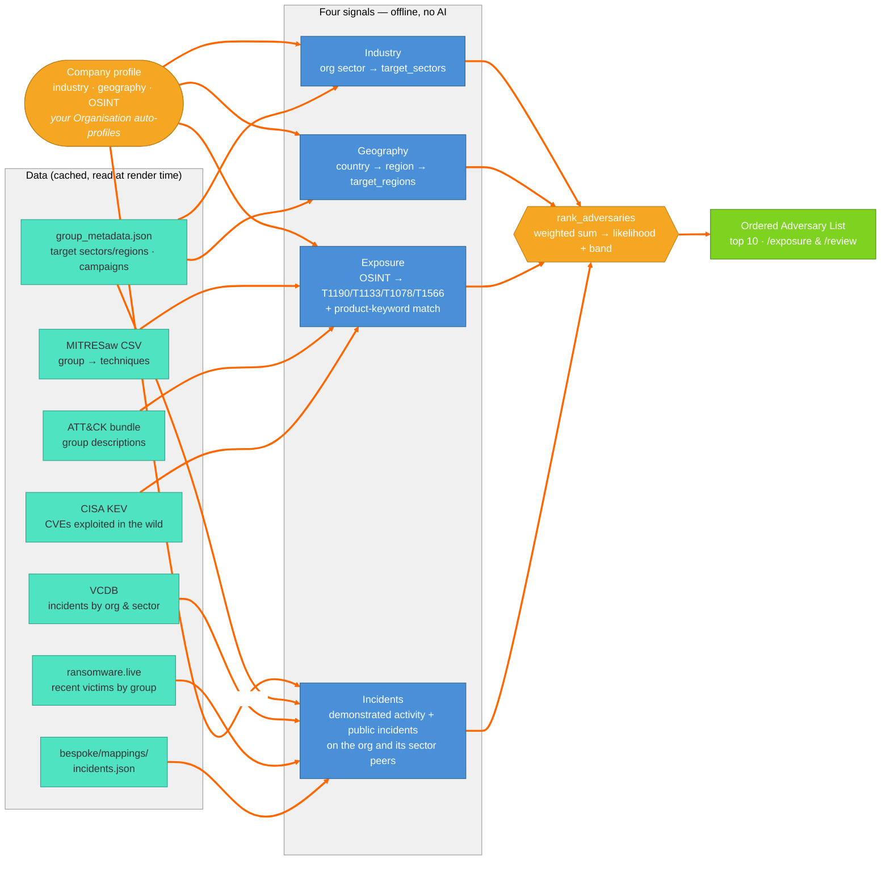

---

## Quick Reference — Explaining Shikari in One Paragraph

> **Shikari** is a tool that turns threat intelligence into working detection queries. You give it the name of a threat actor (like "Scattered Spider"), and it looks up every attack technique that actor is known to use — drawing from the industry-standard MITRE ATT&CK database. For each technique, it extracts the specific indicators (commands, files, network addresses) and builds tailored search queries for your SIEMs (Google SecOps and Microsoft Defender XDR). It then links related detections into attack chains so you can spot multi-step intrusions, not just individual events. Optionally, it can test those detections in a sandboxed environment and cross-reference them against public detection rules. Emulate shows which logs record each technique, from attacks recorded in labs, and whether your detections' indicators appear in them. Everything exports to a spreadsheet, and attack flows to STIX. AI is opt-in throughout.
