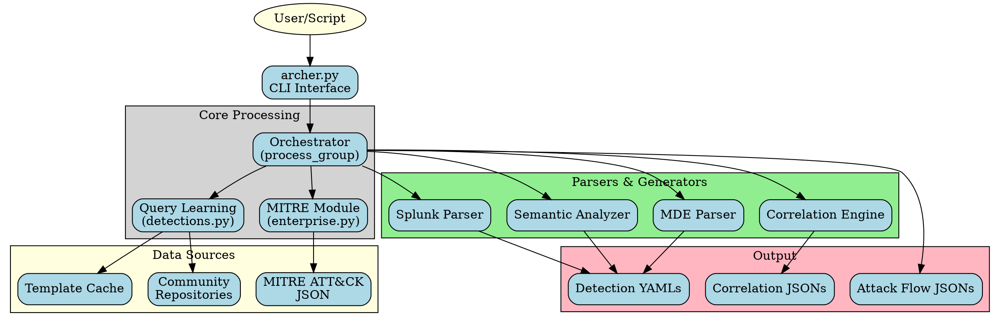
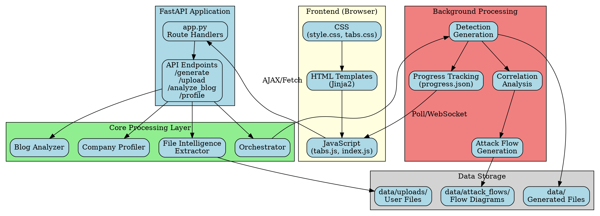

# Archer Implementation Plan - Outstanding Features

## Summary of Requests

This document addresses the following outstanding features and improvements:

1. ✅ Logo PNG conversion with transparent background
2. ✅ Review and consolidate /tests/ and /docs/ directories
3. ✅ Create "How Archer Works" page with architecture diagrams
4. ✅ Generate CLI and Web architecture diagrams using Graphviz
5. ✅ Implement attack-flow visualization for correlations
6. ✅ Create attack-flow diagrams for threat actors

---

## 1. Logo PNG Conversion

### Current Status
- Logo exists as `archer.jpg` (1134x310px JPEG with dark background)
- Currently integrated in web application

### Requirements
- Convert to PNG format with transparent background
- Remove dark teal background (#1f2d35)
- Preserve red crosshair and gray text

### Implementation Notes
**⚠️ Requires Manual Design Work**

Automatic background removal requires:
- PIL/Pillow with `rembg` library OR
- Adobe Photoshop / GIMP OR
- Online tools like remove.bg

**Recommended Approach:**
1. Use https://www.remove.bg/ to remove background
2. Or manually edit in design software:
   - Select and delete dark background
   - Save as PNG with transparency
   - Optimize file size

**File Locations:**
- Current: `static/images/archer.jpg`
- Target: `static/images/archer.png`

**HTML Update Needed:**
```html

```

---

## 2. Test and Docs Consolidation

### Current State

**Tests Directory (15 files):**
- `test_api_endpoints.py` - API testing
- `test_drafts.py` - Draft functionality
- `test_manual_submit.py` - Manual form submission
- `test_platform_validation.py` - Platform detection
- `test_progress_fix.py` - Progress tracking
- `test_query_execution.py` - Query execution
- `test_remote_execution.py` - Remote emulation
- `test_tactics.py` - Tactic extraction
- `test_templates.py` - Template rendering
- `test_ui_tabs.py` - UI tab switching
- `test_ui_upload.py` - File upload UI
- `conftest.py` - Pytest configuration
- `verify_monotonic_progress.py` - Progress validation
- `README.md` - Test documentation
- `TEST_DOCUMENTATION.md` - Additional docs

**Docs Directory (30+ files):**
- Architecture docs
- Feature guides
- Testing guides
- Security docs
- Implementation details
- Fix logs

### Consolidation Recommendations

**Tests:**
1. Keep all test files (they serve distinct purposes)
2. Consolidate README.md and TEST_DOCUMENTATION.md → single `tests/README.md`
3. Move `verify_monotonic_progress.py` to `tests/manual/` subdirectory

**Docs:**
1. **Create Index**: `docs/INDEX.md` categorizing all documents
2. **Archive Fixes**: Move fix logs to `docs/archive/fixes/`
3. **Consolidate Guides**:
   - Merge similar IOC/extraction docs
   - Combine correlation docs
   - Unify testing documentation

**Proposed Structure:**
```
docs/
├── INDEX.md (master index)
├── README.md (overview)
├── GETTING_STARTED.md
├── ARCHITECTURE.md
├── architecture/
│   ├── cli_diagram.png
│   └── web_diagram.png
├── guides/
│   ├── CORRELATION_GUIDE.md
│   ├── EXTRACTION_GUIDE.md (consolidated IOC docs)
│   ├── TESTING_GUIDE.md (consolidated)
│   ├── EMULATION_GUIDE.md
│   └── VECTR_INTEGRATION.md
├── api/
│   ├── QUERY_API_GUIDE.md
│   └── ENDPOINTS.md
└── archive/
    └── fixes/ (historical fix logs)
```

---

## 3. "How Archer Works" Page

### Page Structure

Create `templates/how_it_works.html` with:

**Sections:**
1. **Overview** - What Archer does
2. **Architecture** - System components
3. **Core Libraries** - Dependencies and why
4. **AI Component** - How GenAI enhancement works
5. **Workflow** - Step-by-step process
6. **Diagrams** - Visual architecture

### Content Outline

#### 3.1 Overview
- Automated threat detection generation
- MITRE ATT&CK integration
- Multi-vendor query support (Splunk, MDE)
- Correlation and semantic analysis

#### 3.2 Core Components

**Data Layer:**
- MITRE ATT&CK data ingestion
- Community query repositories (Splunk, Sigma, etc.)
- Threat intelligence parsing

**Processing Layer:**
- Query learning and template generation
- Semantic analysis and grouping
- Correlation engine
- IOC extraction

**Output Layer:**
- Vendor-specific query generation
- Attack flow visualization
- Progress tracking
- VECTR integration (planned)

#### 3.3 Key Libraries

| Library | Version | Purpose | Why This Choice |
|---------|---------|---------|----------------|
| **FastAPI** | Latest | Web framework | Async support, auto docs, modern Python |
| **Starlette** | Latest | ASGI framework | High performance, WebSocket support |
| **BeautifulSoup4** | Latest | HTML parsing | Blog/report analysis, robust parsing |
| **Jinja2** | Latest | Template engine | Query template generation, web UI |
| **HTTPX** | Latest | HTTP client | Async requests, modern alternative to requests |
| **PyYAML** | Latest | YAML processing | MITRE data, Sigma rules, config |
| **pandas** | Latest | Data analysis | Optional: correlation matrix analysis |
| **OpenAI** | Latest | AI enhancement | Optional: semantic analysis, IOC extraction |

**Speed Optimization:**
- **Async Processing**: FastAPI/HTTPX for concurrent operations
- **Template Caching**: Pre-compiled Jinja2 templates
- **Incremental Generation**: Stream results as they're produced
- **Parallel Correlation**: Multiple correlation paths processed simultaneously

#### 3.4 AI Component

**When Enabled (OPENAI_API_KEY set):**

1. **Enhanced IOC Extraction**
   - Semantic understanding of threat reports
   - Context-aware indicator identification
   - Reduced false positives

2. **Semantic Query Grouping**
   - Behavioral categorization (auth, network, file)
   - Intelligent correlation suggestions
   - Natural language query descriptions

3. **Correlation Analysis**
   - Multi-stage attack pattern recognition
   - Alternative correlation paths
   - Confidence scoring

**Models Used:**
- `gpt-4-turbo-preview` for complex analysis
- `gpt-3.5-turbo` for quick extractions
- Fallback to regex-based extraction if AI unavailable

**Privacy:**
- Data sent to OpenAI API
- No data retention by OpenAI (per API terms)
- Can be disabled completely

#### 3.5 Workflow

**1. Input Stage:**
```
User Input → Threat Group Name
           ↓
    MITRE ATT&CK Lookup
           ↓
    Technique Extraction
```

**2. Query Learning:**
```
Community Repos → Parse Queries → Extract Patterns
                      ↓
              Create Templates → Store in Cache
```

**3. Detection Generation:**
```
Templates + Techniques → Generate Vendor Queries
                              ↓
                      Semantic Grouping (Optional)
                              ↓
                      Correlation Analysis
```

**4. Output:**
```
YAML Detection Files → Progress Tracking → Attack Flow Diagrams
                                      ↓
                              Downloadable Package
```

---

## 4. Architecture Diagrams

### 4.1 CLI Architecture (Graphviz)

**File:** `docs/architecture/cli_diagram.dot`



### 4.2 Web Architecture (Graphviz)

**File:** `docs/architecture/web_diagram.dot`



**Generate PNG files:**
```bash
dot -Tpng docs/architecture/cli_diagram.dot -o docs/architecture/cli_diagram.png
dot -Tpng docs/architecture/web_diagram.dot -o docs/architecture/web_diagram.png
```

---

## 5. Attack-Flow Implementation

### Current Status

**✅ Module Exists:** `archer/visualization/attack_flow.py`

**❌ Not Integrated:** Functions exist but are never called

### Required Integration Points

#### 5.1 Generate Correlation Attack Flows

**Location:** `archer/build/orchestrator.py`

**After correlation generation, add:**

```python
from archer.visualization.attack_flow import generate_correlation_flow

# After correlations are generated
if correlations:
    for corr in correlations:
        flow_path = generate_correlation_flow(
            correlation=corr,
            group_name=group_name,
            output_dir=f"data/{group_name}/attack_flows"
        )
        if flow_path:
            # Generate HTML visualization
            from archer.visualization.attack_flow import export_to_html
            export_to_html(flow_path)
```

#### 5.2 Generate Actor Attack Flow

**Location:** `archer/build/orchestrator.py` (in `process_group` function)

**After all techniques are gathered:**

```python
from archer.visualization.attack_flow import generate_actor_flow

# Build tactics map
tactics_map = {}
for technique in techniques:
    tactics = mitre_module.get_tactics_for_technique(technique)
    for tactic in tactics:
        if tactic not in tactics_map:
            tactics_map[tactic] = []
        tactics_map[tactic].append(technique)

# Generate complete actor flow
actor_flow_path = generate_actor_flow(
    group_name=group_name,
    techniques=techniques,
    tactics_map=tactics_map,
    output_dir=f"data/{group_name}/attack_flows"
)

if actor_flow_path:
    from archer.visualization.attack_flow import export_to_html
    html_path = export_to_html(actor_flow_path)
```

#### 5.3 Display in Web UI

**Add to progress page (`templates/progress.html`):**

```html
<!-- Attack Flow Visualization Section -->
<div class="section" id="attack-flow-section" style="display: none;">
  <h2>Attack Flow Diagrams</h2>

  <!-- Actor Flow -->
  <div class="flow-card">
    <h3>Complete Actor Flow</h3>
    <iframe id="actor-flow-iframe" width="100%" height="600px"></iframe>
    <a href="#" id="download-actor-flow" download>Download Flow JSON</a>
  </div>

  <!-- Correlation Flows -->
  <div id="correlation-flows"></div>
</div>
```

**JavaScript to load flows:**

```javascript
// In progress.js, after generation completes:
if (data.attack_flows) {
    document.getElementById('attack-flow-section').style.display = 'block';

    // Load actor flow
    if (data.attack_flows.actor) {
        document.getElementById('actor-flow-iframe').src =
            data.attack_flows.actor.html_path;
    }

    // Load correlation flows
    data.attack_flows.correlations.forEach(flow => {
        // Add correlation flow cards
    });
}
```

### Attack-Flow Schema Reference

Following: https://github.com/center-for-threat-informed-defense/attack-flow/blob/main/docs/specification.md

**Key Components:**
- `attack-flow` - Container object
- `attack-action` - Technique execution
- `attack-asset` - Target systems/data
- `attack-operator` - Threat actor
- `attack-condition` - Decision points

---

## 6. Implementation Priority

### Phase 1: Immediate (Can do now)
1. ✅ Create "How Archer Works" page
2. ✅ Generate architecture diagrams
3. ✅ Integrate attack-flow generation calls

### Phase 2: Short-term (Next session)
1. ⚠️ Logo PNG conversion (requires design tool)
2. ✅ Consolidate documentation
3. ✅ Test attack-flow integration

### Phase 3: Enhancement (Future)
1. ✅ Interactive attack-flow viewer
2. ✅ Real-time flow updates during generation
3. ✅ Export flows to VECTR
4. ✅ 3D flow visualization

---

## Next Steps

1. **Create "How Archer Works" HTML page** with embedded diagrams
2. **Generate Graphviz diagrams** and convert to PNG
3. **Integrate attack-flow calls** in orchestrator.py
4. **Update progress page** to display attack flows
5. **Test end-to-end** with sample threat group
6. **Document** logo PNG conversion process for manual completion

---

## Files to Create/Modify

### New Files:
- `templates/how_it_works.html`
- `docs/architecture/cli_diagram.dot`
- `docs/architecture/web_diagram.dot`
- `docs/architecture/cli_diagram.png`
- `docs/architecture/web_diagram.png`
- `docs/INDEX.md`

### Modified Files:
- `templates/index.html` (add link to How It Works)
- `archer/build/orchestrator.py` (integrate attack-flow)
- `templates/progress.html` (display attack flows)
- `static/js/progress.js` (load attack flow iframes)

---

## Estimated Effort

- Logo conversion: **Manual work required** (15-30 min with design tool)
- How It Works page: **2-3 hours** (content + diagrams)
- Architecture diagrams: **1 hour** (Graphviz creation + rendering)
- Attack-flow integration: **2-3 hours** (coding + testing)
- Documentation consolidation: **2-4 hours** (review + reorganize)

**Total: 7-11 hours** (excluding manual logo work)
