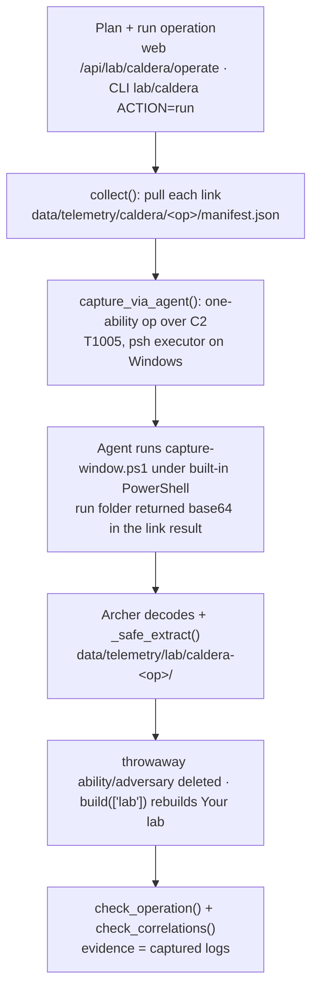

# CALDERA endpoint-log capture on a Windows host — integration evidence and where to review results

After a CALDERA operation runs on a Windows [sandcat](https://github.com/mitre/caldera) agent, Archer reads each step's Windows event logs back **over the agent's own C2 channel** and checks your saved detections and correlations against them. Nothing is installed on the host, no exfiltration directory is used, and no hypervisor access is needed — the whole capture travels in a CALDERA link result over the REST API ([#30](https://github.com/cmdaltr/archer/issues/30)).

This page is the evidence of how that path hooks into Archer and the map of where every capture's results land. The capture mechanism is the same on Linux and macOS (native shell instead of PowerShell); Windows is called out because it is the host that exercises `scripts/telemetry/capture-window.ps1`.

## Why the Windows host closes the gap

The capture command is delivered to the agent base64-encoded and run by whatever shell the agent already has. On Windows that is **built-in Windows PowerShell 5.1** (`capture-window.ps1` is written to parse and run under 5.1 as well as PowerShell 7). So the Windows agent needs no PowerShell 7 install and nothing else added — which is exactly why a Linux agent, lacking PowerShell 7, could never run `capture-window.ps1` and the Windows host was needed to validate it.

## How it directly integrates with Archer

A single operation drives capture → import → check with no manual step in between.



The code path, as evidence:

| Step | Where | What it does |
|---|---|---|
| Plan / run | `archer/lab/web.py` `/caldera/operate`, `archer/cli/modules/lab.py` (`lab/caldera`) → `caldera.operate()` / `caldera.wait()` | Builds the adversary from the planned abilities, starts the operation, waits for it to finish |
| Collect | `caldera.collect()` | Writes every link's technique, command as run, host, times and decoded output to the operation manifest |
| Capture | `caldera.capture_via_agent()` → `caldera._capture_command()` | Creates a one-ability operation (T1005, `psh`/`sh` executors). The Windows `psh` command base64-embeds `capture-window.ps1`, runs it under the agent's own PowerShell, tars the run folder and prints it base64 between markers — so the run returns **in the link result** |
| Import | `caldera._safe_extract()` + `archer.telemetry.__main__.build(["lab"])` | Unpacks the tarball into the lab-run layout, deletes the throwaway ability/adversary, rebuilds **Your lab** |
| Check | `caldera.check_operation()` + `caldera.check_correlations()` | Statically checks saved detections and correlations against the captured logs (no AI, no SIEM); the evidence source flips from *commands* to *captured logs* |

The "direct integration" is that last column end to end: you run one operation, and the captured Windows logs become a normal **Your lab** run that the same static check reads — Archer never leaves its own process to do it, and the host is never touched beyond the agent reading its logs.

## Running the capture on the Windows host

Point Archer at your CALDERA server first — **Profile → Caldera API Endpoint**, or the `caldera:` block in `bespoke/config.yaml` (`url`, `api_key`), or `CALDERA_URL` / `CALDERA_API_KEY`. The Windows sandcat agent must be checked in to a disposable agent group.

> ⚠ A live run detonates a real implant and beacons over C2. Run it only against a throwaway Windows VM, and treat it as a sandboxed task.

**Web / desktop app** — Emulate → Lab → **CALDERA operations** → **Plan an operation** (pick a technique, group or CVE and the agent group) → confirm the agents are disposable → tick **capture the endpoint's logs afterwards → over the agent (CALDERA)** → run.

**Console** —

```
archer-cli > use lab/caldera
archer-cli (lab/caldera) > set ACTION run
archer-cli (lab/caldera) > set TARGET T1033
archer-cli (lab/caldera) > set GROUP disposable
archer-cli (lab/caldera) > set CAPTURE caldera
archer-cli (lab/caldera) > set EXECUTE true
archer-cli (lab/caldera) > run
```

`EXECUTE false` (the default) plans only and creates nothing. `CAPTURE caldera` is the zero-touch path validated here.

## Where to review results from each deployment/capture

| Where | Path / location | What you see |
|---|---|---|
| Operation manifest | `data/telemetry/caldera/<operation>/manifest.json` | Every step: technique, ability, command as run, host/paw, decide/collect/finish times, decoded output (capped). After a capture: `captured: true`, and each step gains `recorded: lab:<run>/<technique>` |
| Captured endpoint logs | `data/telemetry/lab/caldera-<operation>/<technique>-<n>/` (or `caldera-<operation>-<host>/…` when the operation spanned more than one host) | On Windows, `events.xml` — Security, System, PowerShell, Sysmon (if installed), Task Scheduler, WMI, Defender and BITS — in the lab-recorder layout |
| CALDERA operations list | Emulate → Lab → **CALDERA operations** (`GET /api/lab/caldera/operations`) | One row per collected operation: state, group, step count, the hosts it ran on, and a **captured** flag |
| The check | the operation's **Check** on that card (`GET /api/lab/caldera/check?name=<operation>`) | Per technique: **matched / missed / no detection** (evidence shown as *captured logs* once captured); per correlation: **fired / half-fired / missed**, every part on one host inside its window |
| Your lab (platform view) | Emulate → **Platforms** → the captured run | The captured logs as an ordinary **Your lab** run: what your Windows logging records of each technique |
| Console | `archer-cli` → `use lab/caldera` → `set ACTION check` (then `set NAME <operation>`) → `run` | The same per-technique and per-correlation check at the command line; `ACTION check` with no `NAME` lists the collected operations |

`data/telemetry/` is gitignored — the captures carry your VM's and tenant's names and never leave the machine.

## What a passing validation looks like

The Windows capture is validated when a live run shows all of:

- the operation's steps finish on the Windows agent;
- `data/telemetry/lab/caldera-<operation>/…/events.xml` exists and contains that step's events;
- the **Check** flips at least one technique to **matched** off the captured logs rather than the command (e.g. T1033 `whoami`), with the evidence source reported as *captured logs*;
- `captured: true` in the operation manifest.

Until that live Windows run, the C2 capture is validated on Linux and macOS only; see [UNTESTED.md](../other/UNTESTED.md) and the [CALDERA guide](../guide/25-caldera.md).
